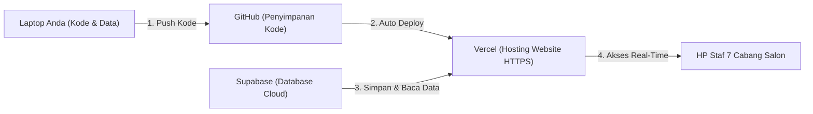

# Panduan Lengkap: Supabase + GitHub + Vercel
## Aplikasi Web: RongsokSalon

Panduan ini dirancang langkah demi langkah (sangat mudah diikuti bahkan jika Anda baru pertama kali menggunakannya) untuk membuat aplikasi **RongsokSalon** berjalan online dan bisa diakses oleh seluruh staf di 7 cabang salon melalui HP masing-masing.

---



---

## TAHAP 1: Menyiapkan Database di Supabase (Gratis)

Supabase adalah database PostgreSQL di cloud yang akan menyimpan seluruh master data salon, area, staf, katalog 1.000 produk, dan transaksi rongsok fisik.

### Langkah-langkah:
1. **Daftar Akun**:
   * Buka browser dan kunjungi: **[https://supabase.com](https://supabase.com)**
   * Klik tombol **Start your project**.
   * Masuk (*Sign In*) menggunakan akun **Google** atau **GitHub** Anda.
2. **Buat Project Database Baru**:
   * Di dashboard utama, klik tombol hijau **New Project**.
   * Isi formulir:
     * **Organization**: Pilih organisasi default Anda.
     * **Name**: Isi dengan `rongsoksalon-db`
     * **Database Password**: Buat password yang aman (misal: gabungan huruf besar, kecil, angka, dan simbol). *Simpan password ini di catatan pribadi Anda.*
     * **Region**: Pilih **Southeast Asia (Singapore)** agar koneksi dari Bali dan seluruh Indonesia super cepat.
     * **Pricing Plan**: Pilih **Free** (Gratis selamanya, kapasitas 500 MB cukup untuk ratusan ribu data transaksi teks).
   * Klik **Create new project** dan tunggu sekitar 1–2 menit hingga Supabase selesai menyiapkan server Anda.
3. **Membuat Tabel & Indeks Otomatis (SQL Editor)**:
   * Di menu navigasi sebelah kiri, klik ikon **SQL Editor** (ikon tanda kurung siku `>_`).
   * Buka file [supabase_schema.sql](file:///c:/Users/Agusta%20Sigit/OneDrive/Documents/Aplikasi%20Salon%20Rosok%20Antigravity/supabase_schema.sql) yang sudah ada di folder laptop Anda.
   * **Salin (Copy) seluruh isi teks** di dalam file `supabase_schema.sql` tersebut.
   * Tempelkan (*Paste*) ke dalam kotak SQL Editor Supabase.
   * Klik tombol **Run** (warna hijau di pojok kanan bawah).
   * *Hasil*: Seluruh tabel (`salons`, `areas`, `staff`, `products`, `transactions`), indeks pencarian 1.000 produk, serta data awal 7 salon otomatis selesai terpasang!
4. **Mengambil Kunci Akses (API Keys)**:
   * Di menu navigasi sebelah kiri bawah, klik **Project Settings** (ikon gerigi) $\rightarrow$ pilih submenu **API**.
   * Cari dan salin dua nilai penting ini:
     1. **Project URL**: (Contoh: `https://abcdefghijkl.supabase.co`)
     2. **Project API keys (anon / public)**: (Rangkaian teks acak panjang)
   * *Biarkan halaman ini tetap terbuka atau simpan dua data ini di Notepad sementara.*

---

## TAHAP 2: Menaruh Kode ke GitHub (Gratis & Privat)

GitHub berfungsi sebagai tempat penyimpanan kode yang aman. Setiap kali Anda ingin meng-update tampilan atau fitur di masa depan, Anda cukup menyimpannya ke GitHub.

### Langkah-langkah:
1. **Daftar / Masuk ke GitHub**:
   * Buka: **[https://github.com](https://github.com)**
   * Masuk dengan akun GitHub Anda (atau daftar baru jika belum memiliki akun, gratis).
2. **Buat Repository Baru**:
   * Di pojok kanan atas, klik tanda plus (**+**) $\rightarrow$ pilih **New repository**.
   * **Repository name**: Ketik `rongsoksalon`
   * **Visibility**: Pilih **Private** (Sangat disarankan agar data dan kode salon Anda bersifat rahasia dan hanya Anda yang bisa melihat).
   * Jangan centang *Add a README file* (karena di laptop Anda sudah ada).
   * Klik tombol hijau **Create repository**.
   * Halaman akan menampilkan alamat link repository Anda, misalnya:
     `https://github.com/USERNAME-ANDA/rongsoksalon.git`
3. **Upload (Push) Kode dari Laptop ke GitHub**:
   * Buka PowerShell di laptop Anda, masuk ke folder aplikasi:
     ```powershell
     cd "c:\Users\Agusta Sigit\OneDrive\Documents\Aplikasi Salon Rosok Antigravity"
     ```
   * Jalankan 5 baris perintah ini satu per satu (ganti `USERNAME-ANDA` dengan username GitHub Anda):
     ```powershell
     git init
     git add .
     git commit -m "First release RongsokSalon App"
     git branch -M main
     git remote add origin https://github.com/USERNAME-ANDA/rongsoksalon.git
     git push -u origin main
     ```
   * *Catatan*: Jika jendela login GitHub muncul, cukup konfirmasi login melalui browser.
   * Sekarang seluruh kode aplikasi Anda sudah tersimpan dengan aman di akun GitHub privat Anda!

---

## TAHAP 3: Menghubungkan GitHub ke Vercel (Online 100%)

Vercel adalah layanan hosting cloud modern yang terintegrasi langsung dengan GitHub dan Next.js. Vercel akan memberikan link website online dengan sertifikat keamanan SSL gratis (`https://...`).

### Langkah-langkah:
1. **Daftar / Masuk ke Vercel Menggunakan GitHub**:
   * Buka: **[https://vercel.com](https://vercel.com)**
   * Klik tombol **Sign Up** (atau **Log In**).
   * Pilih opsi **Continue with GitHub** (ini otomatis menghubungkan akun Vercel dengan GitHub Anda).
2. **Import Project RongsokSalon**:
   * Di dashboard utama Vercel, klik tombol **Add New...** di kanan atas $\rightarrow$ pilih **Project**.
   * Anda akan melihat daftar repository GitHub Anda. Cari repository bernama **`rongsoksalon`**, lalu klik tombol **Import** di sampingnya.
3. **Memasukkan Kunci Database Supabase**:
   * Pada halaman konfigurasi project sebelum klik deploy, cari bagian bertuliskan **Environment Variables**.
   * Klik panah untuk membuka menu tersebut, lalu masukkan 2 data dari Supabase yang Anda simpan di Tahap 1 tadi:
     * **Variabel 1**:
       * *Key*: `NEXT_PUBLIC_SUPABASE_URL`
       * *Value*: Masukkan Project URL Supabase Anda (misal: `https://abcdefghijkl.supabase.co`)
       * Klik **Add**.
     * **Variabel 2**:
       * *Key*: `NEXT_PUBLIC_SUPABASE_ANON_KEY`
       * *Value*: Masukkan anon key Supabase Anda
       * Klik **Add**.
4. **Klik Deploy**:
   * Klik tombol biru besar **Deploy** di bagian bawah.
   * Vercel akan otomatis membaca kode, meng-compile, dan menyalakan server dalam waktu sekitar 45–60 detik.
5. **Selamat! Aplikasi Anda Sudah Online**:
   * Layar perayaan (*Congratulations!*) akan muncul dan Vercel memberikan alamat link resmi website Anda, misalnya:
     **`https://rongsoksalon.vercel.app`**
   * Link inilah yang sekarang bisa dibagikan kepada seluruh manager dan staf di 7 cabang salon!

---

## TAHAP 4: Cara Memasang Aplikasi di Layar Utama HP Staf (PWA)

Aplikasi ini sudah berteknologi **Progressive Web App (PWA)**, artinya staf salon tidak perlu mengunduh apapun dari Google Play Store atau Apple App Store. Cukup pasang pintasan ke layar utama HP:

### A. Untuk HP Android (Browser Google Chrome):
1. Buka Google Chrome di HP staf, lalu ketik alamat website Vercel Anda (misal: `https://rongsoksalon.vercel.app`).
2. Ketuk ikon **Titik Tiga (⋮)** di pojok kanan atas layar Chrome.
3. Pilih menu **"Tambahkan ke Layar Utama"** (*Add to Home screen*) atau **"Pasang Aplikasi"** (*Install App*).
4. Konfirmasi dengan mengetuk **Install / Tambahkan**.
5. Ikon **RongsokSalon** berwarna hijau akan langsung muncul di layar beranda HP. Saat dibuka, aplikasi akan berjalan layar penuh (*fullscreen*) tanpa bar browser seperti aplikasi Android asli!

### B. Untuk iPhone / iPad (Browser Safari):
1. Buka browser **Safari** di iPhone staf, lalu buka alamat link website Vercel Anda.
2. Di bagian bawah layar iPhone, ketuk tombol **Share / Bagikan** (ikon kotak dengan tanda panah mengarah ke atas).
3. Gulir sedikit ke bawah, lalu pilih menu **"Tambah ke Layar Utama"** (*Add to Home Screen*).
4. Ketuk tombol **Tambah** (*Add*) di pojok kanan atas.
5. Selesai! Ikon aplikasi akan langsung terpasang rapi di layar iPhone staf.

---

## TAHAP 5: Cara Melakukan Update Aplikasi di Masa Depan (Otomatis)

Salah satu keunggulan terbesar kombinasi **GitHub + Vercel** adalah kemudahan pembaruan:

Jika di kemudian hari Anda meminta saya (Antigravity) menambahkan fitur baru atau mengubah tampilan:
1. Setelah kode selesai diubah di laptop Anda, Anda cukup membuka PowerShell dan mengetik 3 baris perintah ini:
   ```powershell
   git add .
   git commit -m "Update fitur baru"
   git push
   ```
2. **Vercel secara otomatis mendeteksi perubahan tersebut** dan langsung memperbarui website Anda dalam waktu 30 detik tanpa Anda perlu mengutak-atik settingan apapun lagi! Seluruh HP staf akan langsung mendapatkan versi terbaru secara otomatis saat aplikasi dibuka.

---

## Bantuan & Catatan Keamanan:
* **Keamanan Akun Staf**: Setiap staf yang login terkunci hanya pada salonnya masing-masing. Staf Salon Seminyak tidak akan bisa melihat data salon Canggu atau Ubud.
* **Akun Super Admin**: Untuk melihat seluruh 7 cabang atau mengekspor rekap bulanan, Owner/Manager dapat login menggunakan akun dengan peran `superadmin`.
